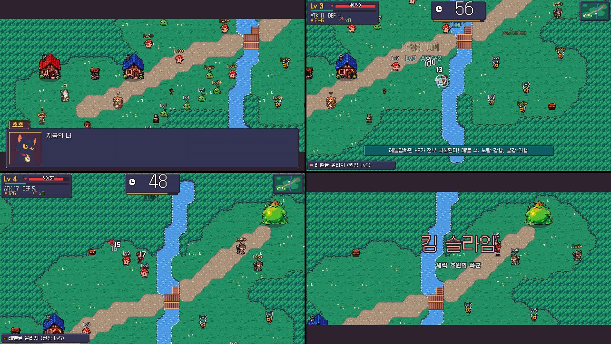
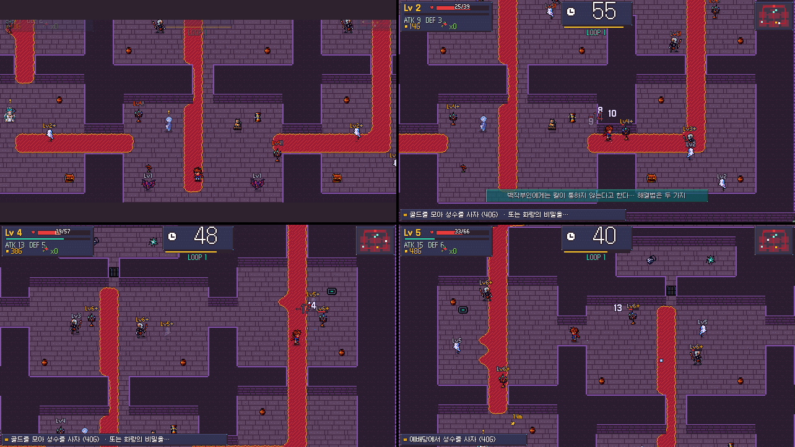

# 데드라인 히어로 (Deadline Hero)

60초 안에 성장·탐험·전투·퀘스트를 끝내는 초압축 픽셀 JRPG.
시간이 끝나면 시간 고양이 초초가 되감아 주지만, **몸만 돌아가고 기억은 남는다.**
알아낸 정보, 고친 다리, 부순 벽, 지난 루프의 내 움직임(메아리)이 다음 루프의 무기가 된다.

## 스크린샷

<p align="center">
  
  
</p>

## 실행 방법

- **권장**: Godot **4.7.2**로 `project.godot`를 열고 F5
- **명령줄**: 저장소 루트에서 `godot --path .`
- **Windows 빌드**: 아래 배포 명령으로 `build/DeadlineHero.exe` 생성 (`build/`는 Git에 포함하지 않음)
- 세이브: `%APPDATA%\Godot\app_userdata\Deadline Hero\deadline_hero_save.json` (타이틀의 "새로 시작"으로 초기화)

## 조작법

| 동작 | 키보드 | 게임패드 |
|---|---|---|
| 이동 | 방향키 / WASD | 십자키 / 왼쪽 스틱 |
| 공격 | 적에게 몸통 박치기 | 〃 |
| 대시 (대시 박치기는 일반 몬스터의 반격 없음) | X / Shift | B / X / RB |
| 대화·조사·결정 | Z / Space / Enter (NPC는 처음 부딪히면 바로 대화) | A |
| 메아리 수첩 | C / Tab | Y |
| 미니맵 끄기·보통·크게 | M | – |
| 일시정지 (되감기·수첩·설정) | Esc / P | Start |
| 루프 되감기 | R 길게 누르기 (0.6초) | Back |
| 전체 화면 | F11 | – |

**마우스**: 메뉴는 가리키면 선택·클릭으로 결정(설정 값은 값의 왼쪽/오른쪽 절반 클릭으로 증감), 휠로 이동, 우클릭은 취소. 대화·결과 화면은 클릭으로 넘기고, 월드맵은 스테이지 점을 클릭해 이동·입장한다. 키보드를 쓰면 커서는 자동으로 숨는다.

**설정** (타이틀 · 일시정지): 음악/효과음/음성 볼륨 10% 단위(←→, 음성 0% = 글자음), 글자 속도 4단계, 미니맵 크기, 화면 흔들림, **번쩍임 줄이기**(섬광·붉은 테두리 약화), **여유 모드**(제한 시간 +50%), 전체 화면.

## 게임 구조

**한 판 = 작은 JRPG 한 편.** 시작 → 마을에서 정보 수집 → 성장·장비 → 선택 → 보스 → 짧은 결말.

- **타이머**: 스테이지당 60초(마지막은 90초). 대화·상점·메뉴 중에는 멈춘다. 10초 이하가 되면 음악이 빨라지고 심장 박동·붉은 비네트·카운트다운 음성이 들어온다.
- **시간 자원**: 고양이 석상에서 골드로 +15초 구매(10→25→50→90G로 비싸짐, 석상은 부활 지점). 숨겨진 모래시계는 +8~10초. 쓰러지면 −10초 후 부활.
- **실패하면**: 실패 분석 카드(레벨/권장 레벨, 보스 남은 체력, 새로 알아낸 것, 다음 루프 팁) → 되감기 연출 → 즉시 다음 루프.
- **클리어 랭크**: 남은 시간 비율 S 40% · A 25% · B 10% 이상. 스테이지마다 숨겨진 ★별 조각.
- **별의 가호**: 찾은 별 조각 1개마다 모든 스테이지 제한 시간 +2초.
- **여유 모드**: 제한 시간 ×1.5. 클리어·진행은 똑같이 인정되고, 최고 기록·랭크는 일반 기록과 따로 저장되어 월드맵에 `(여유 A)`처럼 표시된다. 루프 시작 시점의 설정으로 고정된다.

### 메아리 시스템 (반복이 세계에 흔적을 남긴다)

| 남는 것 | 효과 |
|---|---|
| 메아리 수첩 | 대화·발견으로 얻은 지식이 루프를 넘어 유지. 일부는 지도에 위치 표시 |
| 지름길 | 고친 다리, 부순 벽, 당긴 레버, 연 문, 켠 수정은 되감아도 그대로 |
| 상자 기억 | 한 번 연 상자는 다음 루프부터 미니맵에 표시 |
| 메아리 유령 | 지난 루프의 내 움직임이 청록색 유령으로 재생. 발판을 대신 밟아 준다 |
| 데자뷔 NPC | 만난 적 있는 NPC는 다른 대사를 하고 아이템을 먼저 건네주기도 한다 |
| 보스 예측 | 이전 루프에서 본 보스는 큰 공격 예고가 조금 일찍 뜬다 |
| 몸의 기억 | 실패한 루프마다 경험치 +10% (최대 +50%) |
| 메아리 계승 | 2번째 루프부터 시작할 때 지난 루프 최고 레벨의 약 60%(최소 Lv2)로 시작할지 고른다. 올린 레벨당 3초를 낸다. 마지막 선택을 기억한다 |
| 최종전 | 지금까지의 루프·쓰러짐 횟수만큼 메아리 동료가 함께 싸운다 |

보스는 몸통 박치기에 반격한다. 기절·빈틈·코어 개방처럼 **빛나는 순간**에만 안전하게 큰 피해를 줄 수 있다.
늑대·광석 딱정벌레·불도롱뇽은 **반격형 몬스터**다. 돌진 준비 동작이나 돌진 후 쉬는 동안(몸이 빛날 때)만 제대로 들어가고, 그 밖에는 대시로 들이받아도 피해가 반으로 줄고 반격을 받는다. 적 레벨 표시의 `+`(1~2 높음) · `!`(3~5 높음) · `!!`(6 이상 높음)는 색을 구분하기 어려워도 위험도를 알 수 있게 붙는 기호다. 타격마다 방향이 있는 베기 궤적과 짧은 전진 모션이 나온다.

### 스테이지

| # | 스테이지 | 새 아이디어 | 권장 |
|---|---|---|---|
| 1 | 새싹 초원 | 기본 루프: 성장 → 철검 구매 → 킹 슬라임. 숲속 샛길의 비밀 | Lv5 |
| 2 | 끊어진 다리 | 판자 3장으로 다리를 영구 수리 vs 매 루프 뱃삯 vs 숨겨진 통나무 다리 | Lv7 |
| 3 | 어둠의 광산 | 좁은 시야, 탐험한 지도·켠 수정·부순 벽·광차 레버가 루프를 넘어 유지 | Lv7 |
| 4 | 유령 저택 | 성수를 사서 싸우기 **또는** 메아리와 발판 협동 → 로켓 → 싸우지 않는 해결 | Lv7 |
| 5 | 거울 신전 | 정면을 막는 기사(등 공격), 레버·열쇠 문, 라이벌의 데자뷔 | Lv8 |
| 6 | 불꽃 화산 | 40초·22초에 저지대가 용암에 잠김 → 대장간·석상 방문 순서가 전략 | Lv8 |
| 7 | 종말의 시계탑 | 90초·3층(층마다 카메라가 현재 층만 비춤), 2단계 마왕(시곗바늘·시간 정지), 메아리 동료 → 엔딩 | Lv10 |

## 사용 기술

- **엔진**: Godot 4.7.2, GDScript, GL Compatibility 렌더러, 640×360 정수 배율 픽셀 렌더링
- **그래픽**: Codex CLI 내장 `image_gen`으로 원화(몬스터·보스·NPC·초상화·아이템·소품·타이틀·월드맵·엔딩)를 생성한 뒤 `tools/process_sprites.py`에서 배경 키잉 → 픽셀 모드 다운스케일 → **Resurrect 64 팔레트** 스냅 → 외곽선 처리. 타일셋(듀얼 그리드 지형 7종)·UI·아이콘은 같은 팔레트로 절차적 생성
- **음성**: Fish Audio TTS (`s2.1-pro-free`) 62줄. 일반 라이브러리 목소리 + ffmpeg 후처리(피치·에코)로 캐릭터를 구분. 결과는 `assets/audio/voice/*.ogg`에 캐시되어 API 없이 플레이 가능, 원본 응답은 `tools/voice_raw/`에 캐시. 음성 파일이 없거나 음성을 끄면 텍스트만으로 진행
- **음악·효과음**: 자체 Python 칩튠 신시사이저(`tools/synth.py`) — 14곡, 효과음 63종. 스테이지 곡은 32마디(A 16 + 브리지 8 + A 후반 8, 48~69초)라 60초 루프 안에서 같은 구간이 두 번 넘게 반복되지 않는다. 리버브를 원형으로 처리해 루프 이음새에서 튀는 소리가 없다
- **폰트**: Galmuri (Lee Minseo, SIL OFL 1.1)

## 폴더 구조

```
data/            게임 콘텐츠 (코드와 분리)
  campaign.json  스테이지 순서·월드맵 좌표
  stages/sN.json 스테이지별 마커·NPC 대사·상점·지식·목표·힌트·팁
  maps/sN.txt    ASCII 맵 (tools/maps.py로 생성)
  enemies.json   몬스터(레벨 배율)·보스 수치     items.json  아이템
  voice_lines.json / voices.json  음성 대사와 캐스팅
scripts/
  autoload/      game(세이브·마이그레이션·입력·설정) audio(음악·효과음·음성) db(데이터)
  game/          stage(루프·전투·연출) stage_events(조건·효과·대화·상점) boss enemy hero map_builder fx bot(자동 플레이테스터)
  ui/            hud dialog_box menu settings_menu credits title_screen world_map ending_screen
  debug/         debug_harness(스크린샷·시나리오·selftest) test_runner(자동 테스트) — 디버그 인자가 있을 때만 생성
assets/          가공된 스프라이트·타일·초상화·UI·오디오·폰트
tools/           에셋 파이프라인 (Godot 임포트 제외). art_src = Codex 원본, voice_raw = TTS 응답 캐시
build/           Windows 빌드 + THIRD_PARTY_NOTICES.txt
```

git 저장소(`main`)가 초기화되어 있다. `.gitignore`는 `.godot/`, `build/`, `tools/_*/`(렌더링 임시 파일·스크린샷), `__pycache__/`를 제외한다.

## 콘텐츠 추가

- **새 스테이지**: `tools/maps.py`에 맵 함수 추가 → `data/stages/sN.json` 작성(마커 문자 → 적/NPC/소품 정의) → `data/campaign.json`에 등록. 조건(`know:`, `cut:`, `item:`, `lv>=`, `met` 등)과 효과(`item`, `know`, `shortcut`, `warp`, `shop`, `choice` 등)는 `scripts/game/stage_events.gd` 참고
- **새 적**: `data/enemies.json`에 스프라이트·AI·배율 추가 (레벨은 스테이지 마커에서 지정)
- **새 음성 대사**: `data/voice_lines.json`에 추가 후 `python tools/gen_voice.py` (환경 변수 `FISH_API_KEY` 필요, 이미 만든 줄은 캐시 사용)

## 에셋 재생성

```powershell
python tools/maps.py           # data/maps/*.txt
python tools/make_tiles.py     # assets/tiles/*.png
python tools/make_ui.py        # UI·아이콘·절차 소품
python tools/process_sprites.py; python tools/process_illust.py   # Codex 원화 → 게임 에셋
python tools/make_sfx.py; python tools/make_music.py              # 효과음·음악 (ffmpeg 필요)
python tools/gen_voice.py      # 음성 (캐시 우선)
```

## 테스트·디버그

실행 인자는 `--` 뒤에 붙인다.

- `--stage=s3` 특정 스테이지 바로 시작 · `--fresh` 테스트 전용 세이브로 초기화(플레이어 세이브는 건드리지 않음)
- `--bot` 목표 화살표만 보고 플레이하는 자동 플레이테스터 (A* 경로·보스 빈틈 공략)
- `--scenario=selftest` 모든 음성·음악·스테이지 데이터 로드 확인 (빌드에서도 동작)
- `--scenario=tests` 자동 테스트 (`tools/run_tests.ps1`, 실패 시 종료 코드 1). 조건식 해석, 경험치·피해·계승·랭크 공식, 세이브 마이그레이션·JSON 왕복, 그리고 스테이지 데이터 검증(마커·NPC·적·아이템·상점·음성·지식 참조, 알 수 없는 조건식/효과 차단, `@`에서 모든 마커까지 도달 가능한지 BFS로 확인 — 수리할 다리·문·워프·광차 경로 포함)
- `--scenario=ui` · `moments` · `credits` 메뉴와 주요 순간(반격, 약점, 계승 메뉴, 실패 카드, 결과…) 자동 스크린샷 → `tools/_shots/`
- `--scenario=mouse` (창 모드) 가상 마우스 입력으로 메뉴 hover·휠·값 조절 클릭·선택 클릭 확인
- `--scenario=licenses` 실행 파일 옆에 `THIRD_PARTY_NOTICES.txt` 생성
- `tools/balance.ps1` 전 스테이지 자동 플레이 결과(클리어 루프·남은 시간) 요약

```powershell
powershell -File tools\run_tests.ps1
build\DeadlineHero.exe --headless -- --scenario=selftest
powershell -File tools\balance.ps1 -Stages "s1,s2"
```

자동 플레이테스터 기준 결과(마지막 측정): 1·4스테이지 1루프, 2·5·6·7스테이지 2루프, 3스테이지 4루프 안에 클리어. 4스테이지는 메아리 발판 협동으로 Lv2 평화 해결(2루프)도 확인했다. 봇은 무작위 요소가 있어 같은 스테이지도 실행마다 1~2루프 정도 차이가 난다. 사람의 체감 난이도는 따로 확인이 필요하다.

세이브에는 `version`이 있고 이전 형식은 불러올 때 자동으로 변환된다(`Game.migrate_save`).

## 크레딧

- 기획·프로그래밍·레벨 디자인·음악/효과음 합성: Kiro (Claude Opus 5.5)
- 원화 생성: Codex CLI image_gen · 음성: Fish Audio TTS
- 폰트: [Galmuri](https://github.com/quiple/galmuri) (OFL, `assets/fonts/LICENSE.txt`)
- 팔레트: Resurrect 64 by Kerrie Lake
- 엔진: Godot Engine (MIT). 게임 안 타이틀 → 크레딧에서 라이선스 전문을 볼 수 있다
- 캐릭터·세계관·맵·UI·스토리·시스템은 모두 이 프로젝트를 위해 새로 만든 것이며, 『용사 30』의 압축 구조에서 영감만 받았다.

## 배포 전 확인

2026-09-30 기준으로 조사한 내용이다. 법률 자문이 아니므로 공개·판매 전에 각 원문을 다시 확인한다. (출처 문구는 요약·의역했다.)

| 항목 | 확인한 내용 | 배포 전 할 일 |
|---|---|---|
| Fish Audio 음성 (62줄) | 약관상 유료 서비스 이용자가 아니면 개인·비상업 용도로 한정되고, 유료 이용자는 상업적 이용이 허용된다 ([이용약관](https://fish.audio/terms/)). 무료 모델 `s2.1-pro-free` 안내에는 일부 상업 시나리오에 제한이 있을 수 있고 연 매출 100만 달러 초과 제품은 사전 문의가 필요하다고 적혀 있다 ([S2.1 Pro Free 안내](https://fish.audio/blog/s2-1-pro-free-api/)). 라이브러리 목소리는 다른 사용자가 올린 모델이라 모델별 조건도 따로 봐야 한다 | 상업 배포라면 유료 플랜으로 다시 생성(`tools/voice_raw/` 캐시를 지우고 `python tools/gen_voice.py`)하거나 음성 파일을 빼고 글자음만으로 배포. 사용한 목소리 ID는 `data/voices.json` |
| Codex `image_gen` 원화 | OpenAI 약관은 입력의 권리는 사용자에게 남고 출력은 사용자에게 귀속(양도)된다고 설명한다 ([도움말](https://help.openai.com/en/articles/5008634-will-openai-claim-copyright-over-what-outputs-i-generate-with-the-api), [이용약관](https://openai.com/policies/row-terms-of-use)). 약관 원문 페이지는 이번 조사에서 자동 접속이 막혀(HTTP 403) 검색 결과 요약으로 확인했다. AI 생성물은 나라에 따라 저작권 보호 범위가 제한될 수 있다 | 약관 원문 재확인. `tools/art_src/` 원화가 기존 작품·캐릭터와 닮지 않았는지 육안 점검 |
| Godot Engine (MIT) | 라이선스 문구를 게임 안이나 함께 배포하는 파일로 사용자에게 제공해야 하고, 엔진에 포함된 서드파티 라이브러리 고지도 함께 챙기라고 안내한다 ([Godot 문서](https://docs.godotengine.org/en/stable/about/complying_with_licenses.html)) | 타이틀 → **크레딧** 화면에 Godot 라이선스 전문이 들어 있다. 빌드 폴더에 `THIRD_PARTY_NOTICES.txt`도 같이 배포 (아래 명령) |
| Galmuri 폰트 (SIL OFL 1.1) | 폰트 단독 판매 금지, 라이선스 동봉 | `THIRD_PARTY_NOTICES.txt`에 전문 포함 |
| Resurrect 64 팔레트 | 제작자 표기 | 크레딧에 표기됨 |
| 빌드 메타데이터 | `export_presets.cfg`의 `application/copyright`는 임시 문구 | 실제 저작권자 이름으로 바꾼 뒤 다시 내보내기 |

```powershell
# 빌드 + 고지 파일 생성 + 자체 점검
godot --headless --path . --export-release "Windows Desktop" "build/DeadlineHero.exe"
build\DeadlineHero.exe --headless -- --scenario=licenses   # exe 옆에 THIRD_PARTY_NOTICES.txt 생성
build\DeadlineHero.exe --headless -- --scenario=selftest
```
